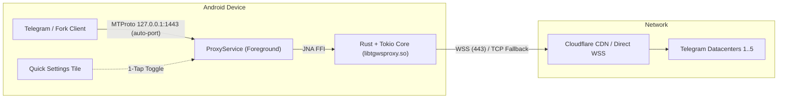

# ⚡ TgwsProxyAndroid

**Высокопроизводительный локальный MTProto WebSocket прокси для Telegram на Android**

[](https://github.com/wqeww0001/TgwsProxyAndroid/releases/latest)
[-34d399?style=flat-square&logo=android)](https://developer.android.com)
[](https://www.rust-lang.org/)
[](https://github.com/wqeww0001/TgwsProxyAndroid)
[](https://developer.android.com/jetpack/compose)
[](LICENSE-GPLv3)
[](https://github.com/wqeww0001/TgwsProxyAndroid/releases)
[](https://github.com/wqeww0001/TgwsProxyAndroid)

[**Промо-сайт**](https://wqeww0001.github.io/TgwsProxyAndroid/) • [**Скачать APK (Релизы)**](https://github.com/wqeww0001/TgwsProxyAndroid/releases/latest) • [**Быстрый старт**](#-быстрый-старт) • [**Возможности**](#-ключевые-возможности) • [**Настройки**](#️-настройки-и-параметры) • [**Сборка**](#️-сборка-из-исходников) • [**English Summary**](#-english-summary)

---

## 📖 О проекте

**TgwsProxyAndroid** — это клиентское Android-приложение со встроенным асинхронным **Rust + Tokio ядром** (`libtgwsproxy.so`), которое поднимает изолированный локальный MTProto-прокси (по умолчанию `127.0.0.1:1443` с динамическим fallback на свободный loopback-порт) прямо на вашем смартфоне без системного VPN.

Приложение туннелирует трафик датацентров Telegram (`DC 1..5`) поверх защищённых `WSS`-соединений через **Cloudflare CDN** или прямой `WSS` к серверам Telegram (`kws{dc}.web.telegram.org`) с автоматическим прогревом пула и прозрачным fallback на прямой TCP.

---

## ✨ Ключевые возможности

### 🚀 Производительность и протокол
- **Асинхронное ядро на Rust + Tokio (`libtgwsproxy.so`)**: неблокирующая обработка сокетов через JNA-мост с минимальным потреблением памяти и околонулевой задержкой. Сборка под все основные архитектуры: `arm64-v8a`, `armeabi-v7a`, `x86_64` с нативной проверкой живости слушателя (`IsListening`).
- **Динамический выбор порта**: основной порт — `1443`. Если он занят другим процессом, приложение автоматически находит свободный локальный порт, сохраняет его и мгновенно обновляет ссылку подключения.
- **Гибкая маршрутизация Cloudflare CDN / Direct WSS**: переключатель приоритета (`CF-first` или сначала прямой `WSS` к DC Telegram) и умный fallback на прямой TCP.
- **Пул быстрых WebSocket-соединений**: настраиваемый пул (`2`, `4` или `6` соединений), keepalive-пинги и автоматический перезапуск при переключении между Wi-Fi и мобильной сетью.
- **Экспресс-тест дата-центров Telegram (DC1–DC5)**: встроенная диагностика в 1 тап — замер задержки и доступности `WSS :443` и прямого `TCP :443` до всех 5 дата-центров Telegram в реальном времени.

### 🔋 Энергоэффективность и фоновая работа
- **Умный режим сна (Smart Standby)**: сервис отслеживает состояние экрана и активный входящий/исходящий трафик (`down` / `up`) — при выключенном дисплее и простое частота фонового опроса снижается до 30 секунд. При появлении трафика или включении экрана активный режим возвращается мгновенно.
- **Надёжный автозапуск на любых прошивках**: поддержка автозапуска после перезагрузки смартфона с кнопкой быстрого перехода в настройки OEM-систем управления фоном (MIUI/HyperOS, ColorOS, Funtouch/Vivo, EMUI). При сбое автозапуска система присылает информативное уведомление с причиной.
- **Плитка в шторке (Quick Settings Tile)**: включение и отключение прокси в **1 тап** прямо из панели быстрых настроек Android со статусом на выбранном языке.

### 🎨 Современный интерфейс (Material Design 3)
- **Тёмные темы оформления по умолчанию**: глубокая палитра `Тёмная (Dark)`, неоновая `Аврора (Aurora)` и тёплый `Закат (Sunset)` с автоматической адаптацией статус-бара (светлая тема исключена для снижения энергопотребления OLED-экранов).
- **Мультиязычность (13 языков)**: полный перевод интерфейса, уведомлений и плитки на Русский, English, Қазақша (`kk`), O‘zbekcha (`uz`), Español (`es`), Français (`fr`), Deutsch (`de`), Polski (`pl`), 中文 (`zh`), 日本語 (`ja`), 한국어 (`ko`), ქართული (`ka`) и العربية (`ar`).
- **Высокая отзывчивость без лишних рекомпозиций**: изолированное обновление таймера аптайма, версионированный буфер логов и виртуализированный журнал отладки на `LazyColumn`.
- **Центр обновлений и Архив версий (Rollback)**:
  - Переключение между каналами **Стабильная (Stable)** и **Бета / Снапшот (Beta)**.
  - Окно обновлений с форматированным списком изменений и автоматическим перезапуском прокси после установки.
  - Встроенный **Архив всех релизов** с возможностью отката на любую предыдущую версию в 1 клик и автоматической очисткой кэша APK.
- **Резервное копирование настроек**: экспорт и импорт всей конфигурации прокси в формате JSON или по ссылке.
- **Статистика трафика**: точный учёт принятых и отправленных данных (`↓` / `↑`) за сегодня и за всё время с гарантированным сохранением финальных байтов при остановке сервиса.

### 🔒 Безопасность
- **Аппаратное хранилище ключей (Android Keystore)**: локальный MTProto-секрет генерируется на устройстве и шифруется алгоритмом **AES-GCM** с неэкспортируемым ключом.
- **Очистка ключевого материала (`Drop`)**: ключи и IV потока `AES-CTR` зануляются в памяти Rust по завершении соединения.
- **Проверка целостности и подписи APK**: перед установкой обновления проверяется валидность APK-архива, совпадение `packageName` и криптографического сертификата подписи (`SHA-256`).

---

## 🛠️ Схема работы



---

## 🚀 Быстрый старт

1. Скачайте актуальный APK со страницы **[Релизов (Releases)](https://github.com/wqeww0001/TgwsProxyAndroid/releases/latest)** и установите его.
2. Нажмите **«Запустить»** на главном экране и дождитесь статуса **«Подключено»**.
3. Нажмите **«Открыть в Telegram»** и подтвердите добавление прокси `127.0.0.1:1443` (или динамически выбранного порта).

> [!WARNING]
> **Если при обновлении возникает ошибка «Update signing certificate mismatch» / «Приложение не установлено»:**
> Удалите старую версию приложения с телефона и установите новый APK со страницы [Releases](https://github.com/wqeww0001/TgwsProxyAndroid/releases/latest) заново. Начиная с актуальных релизов используется единый постоянный ключ подписи, поэтому все последующие обновления будут устанавливаться поверх без удаления.

---

## ⚙️ Настройки и параметры

| Параметр | Описание | По умолчанию |
| :--- | :--- | :--- |
| **Язык интерфейса** | Выбор одного из 13 поддерживаемых языков (RU, EN, KK, UZ, ES, FR, DE, PL, ZH, JA, KO, KA, AR) | `Русский` |
| **Оформление (Appearance)** | Выбор тёмной темы: `Тёмная (Dark)`, `Аврора (Aurora)`, `Закат (Sunset)` | `Тёмная (Dark)` |
| **Тест DC1–DC5** | Диагностика в 1 тап: пинг WSS :443 и TCP :443 до дата-центров Telegram | По запросу |
| **Cloudflare домен** | Пользовательский домен для WSS-маршрутизации (пусто = встроенный список + TCP fallback) | Встроенный |
| **Cloudflare CDN** | Использование Cloudflare CDN для обхода DPI | Включено |
| **Приоритет Cloudflare (`CF-first`)** | `Вкл` = сначала CDN-маршрут; `Выкл` = сначала прямой WSS к DC Telegram | Включено |
| **Датацентры Telegram (DC → IP)** | Пользовательское перенаправление датацентров в формате `номерDC:IPv4` | По умолчанию |
| **Пул быстрых соединений** | Количество готовых параллельных WSS-соединений (`2`, `4` или `6`) | `4` |
| **Умный режим сна (Smart Standby)** | Снижение фоновой активности при выключенном экране и отсутствии трафика | Включено |
| **Автозапуск прокси** | Запуск сервиса при включении устройства + быстрый доступ к OEM-настройкам | Выключено |
| **Канал обновлений** | Выбор между `Стабильная (Stable)` и `Бета / Снапшот (Beta)` + архив версий | `Стабильная` |

---

## 🏗️ Сборка из исходников

### Требования
- **Android Studio** Ladybug (или новее) / **Android SDK 37**
- **Android NDK** `27.x` или новее
- **JDK 21** (Temurin / OpenJDK)
- **Rust stable** + утилита `cargo-ndk`

### Пошаговая инструкция

1. **Клонируйте репозиторий:**
   ```bash
   git clone https://github.com/wqeww0001/TgwsProxyAndroid.git
   cd TgwsProxyAndroid
   ```

2. **Установите таргеты Rust и соберите native-библиотеки (`libtgwsproxy.so`):**
   ```powershell
   cargo install cargo-ndk --locked
   rustup target add aarch64-linux-android armv7-linux-androideabi x86_64-linux-android

   # Сборка .so библиотек для arm64-v8a, armeabi-v7a и x86_64:
   .\build_so.bat
   ```

3. **Запустите тесты и соберите Debug APK:**
   ```powershell
   .\gradlew.bat testDebugUnitTest assembleDebug
   ```
   *Собранный файл:* `app/build/outputs/apk/debug/app-debug.apk`

4. **Сборка подписанного Release APK:**
   Создайте файл `local.properties` в корне проекта (он исключён из Git):
   ```properties
   RELEASE_STORE_FILE=tgwsproxy-release.jks
   RELEASE_STORE_PASSWORD=your_store_password
   RELEASE_KEY_ALIAS=tgwsproxy
   RELEASE_KEY_PASSWORD=your_key_password
   ```
   Выполните:
   ```powershell
   .\gradlew.bat assembleRelease
   ```
   *Собранный файл:* `app/build/outputs/apk/release/app-release.apk`

---

## 🌐 English Summary

**TgwsProxyAndroid** is a high-performance local MTProto WebSocket proxy client for Telegram on Android powered by an asynchronous **Rust + Tokio** core (`libtgwsproxy.so`) on `127.0.0.1:1443` (with automatic fallback to a free loopback port if busy).

### Highlights:
- **Rust + Tokio Core (`MTProto WS`)**: Routes Telegram DC (`1..5`) traffic over TLS 1.3 WebSockets (`WSS`) with configurable Cloudflare CDN priority (`CF-first` vs direct WSS) and automatic TCP fallback. Native socket listener health check via `IsListening`.
- **Dynamic Port Selection**: Defaults to `1443`; if the port is in use, automatically selects and saves a free local loopback port and updates the proxy link.
- **Smart Standby Battery Saver**: Automatically throttles background polling when the screen is off and no download/upload traffic is active.
- **Material 3 UI & Dark Themes**: Sleek Jetpack Compose interface featuring deep `Dark`, `Aurora`, and `Sunset` themes optimized for OLED displays (light theme removed).
- **Full Multilingual Support (13 Languages)**: Complete translations for Russian, English, Kazakh (`KK`), Uzbek (`UZ`), Spanish (`ES`), French (`FR`), German (`DE`), Polish (`PL`), Chinese (`ZH`), Japanese (`JA`), Korean (`KO`), Georgian (`KA`), and Arabic (`AR`), including notifications and Quick Settings tile.
- **1-Tap Telegram DC Benchmark (DC1–DC5)**: Live latency testing to all 5 Telegram datacenters across both `WSS :443` and `TCP :443`.
- **In-App Updater & Version Archive**: Supports `Stable` and `Beta` update channels, formatted Markdown changelogs, automatic service restart after update, automated APK cache cleanup, and 1-click rollback to any previous release.
- **Hardware-Backed Security**: Local MTProto secret encrypted with **AES-GCM** via Android Keystore and APK signing certificate verification (`SHA-256`).

---

## 🤝 Участие в разработке

Мы рады новым идеям, баг-репортам и пул-реквестам! Перед началом работы ознакомьтесь с документами:
- [Руководство по участию (Contributing Guide)](CONTRIBUTING.md)
- [Кодекс поведения (Code of Conduct)](CODE_OF_CONDUCT.md)
- [Политика безопасности (Security Policy)](SECURITY.md)

---

## 📜 Лицензия

Проект распространяется под свободной лицензией **GNU General Public License v3.0 (GPLv3)**. Подробности в файле [LICENSE-GPLv3](LICENSE-GPLv3).
